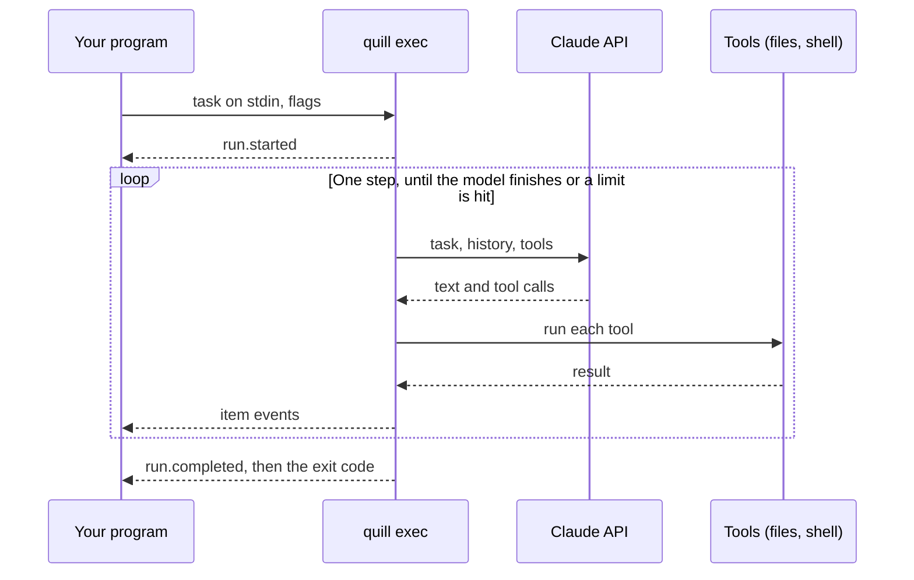

# Quill

[](https://github.com/ag2trust/quill/actions/workflows/ci.yml)

**A small, headless coding agent for Claude.** Give Quill a task and a directory. It works
with the model until the task is done, then tells you what happened in JSON.

Quill has no user interface. It is made to be started by another program: one process, one
task, a stream of events on stdout, and an exit code you can rely on.

> **Status: proof of concept.** Quill was built on 2026-11-08 and works end to end, but it
> is not ready for production. Its shell tool runs commands as your user, so run it in a
> container or on code you trust. See the [safety baseline](#proposed-safety-baseline).

## Contents

- [How it works](#how-it-works)
- [Quick start](#quick-start)
- [What Quill does](#what-quill-does)
- [Why](#why)
- [Finding your way around](#finding-your-way-around)
- [Contributing](#contributing)
- [Decided](#decided): the full specification
- [Proposed safety baseline](#proposed-safety-baseline)
- [Prior art](#prior-art-headless-cli-interfaces)

## How it works

Quill is a harness: an API client running a loop. It sends the model the task and the
available tools, runs the tool the model requests, returns the result, and repeats until the
model finishes or a limit is hit. One pass through that loop is a **step**. One Quill process
handling one prompt is a **run**.



## Quick start

Static binaries for linux/amd64, linux/arm64, and darwin/arm64 are on the
[releases page](https://github.com/ag2trust/quill/releases), with `SHA256SUMS`; see
[Releases](#releases-2026-11-20). To build from source, you need Go 1.26.11 or later. Either
way, you need an Anthropic API key.

```bash
git clone https://github.com/ag2trust/quill
cd quill
go build -o quill ./cmd/quill
export ANTHROPIC_API_KEY=...   # the only place Quill reads the key from
```

Start with a read-only run. With `--tools read-only` the model can read and search the
workspace, but has no write, edit, or shell tools:

```bash
echo "Explain what this repository does" \
  | ./quill exec --tools read-only --workspace /path/to/repo -
```

Quill writes one JSON event per line. Abridged, a run looks like this:

```text
{"type":"run.started","format":2,"model":"claude-opus-5-5","effort":"high","tool_profile":"read-only", ...}
{"type":"item.started","item":{"type":"tool_call","id":"toolu_01...","name":"read","input":{"path":"README.md"}}}
{"type":"item.completed","item":{"type":"tool_call","id":"toolu_01...","name":"read","input":{"path":"README.md"},"text":"# ..."}}
{"type":"item.completed","item":{"type":"message","text":"This repository is ..."}}
{"type":"run.completed","status":"completed","final_text":"This repository is ...","usage":{...},"steps":2,"duration_ms":8400}
```

To print only the answer, pick `final_text` from the last event:

```bash
echo "Explain what this repository does" \
  | ./quill exec --tools read-only --workspace /path/to/repo - \
  | jq -r 'select(.type == "run.completed") | .final_text'
```

To let Quill change code, leave out `--tools read-only`. The default profile, `read-write`,
adds the write, edit, and shell tools. Quill does not sandbox them: the container you run
it in is the sandbox.

```bash
echo "Fix the failing test in ./internal/parser" \
  | ./quill exec --workspace /path/to/repo --session "$HOME/fix-parser.jsonl" -
```

`--session` keeps the conversation in a file outside the workspace, so a later run with
the same file continues where this one stopped.

A model run costs money. Every run is capped by `--max-steps`, `--max-tokens`, and
`--timeout`; the defaults are in [Decided](#decided), under Command line.

## What Quill does

- **Eight tools.** `read`, `write`, `edit`, `list`, `glob`, `search`, `shell`, and
  `raise_blocker`. The `read-only` profile leaves out `write`, `edit`, and `shell`.
- **Events you can parse.** stdout is always JSON lines: one `run.started`, the tool calls
  and messages as they happen, and exactly one `run.completed` with the status, the final
  text, and token usage.
- **Typed outcomes.** Each `status` has its own exit code, and provider failures carry an
  `error.kind` that says whether a retry makes sense. Callers never match error text.
- **Hard limits.** Steps, tokens, run time, and the time of each shell command are capped.
  Every wait ends by `--timeout`.
- **Sessions.** Quill is stateless. A session file lets a new run continue an earlier one,
  including after a crash or a stop.
- **Blockers.** When the task is unclear or conflicts with the repository's rules, the
  model stops and asks instead of guessing. The run ends with status `blocked`, and the
  caller answers by continuing the session.
- **Repository instructions.** `AGENTS.md` and `CLAUDE.md` in the workspace root are given
  to the model as repository content.
- **Extra tools over MCP.** `--mcp-url` adds the tools of one MCP server that the caller
  configures.
- **Long runs.** Prompt caching and context compaction are always on.

Each of these is specified under [Decided](#decided).

What Quill leaves out on purpose: a terminal UI, chat, permission prompts, plugins,
subagents, web search, and orchestration. Orchestration belongs to the caller.

## Why

- One CLI and one typed error model, using API keys instead of vendor logins.
- A simple container story: one static binary and no third-party CLIs to install or
  redistribute.
- Typed failures, so callers never have to match CLI error text.

## Finding your way around

| Where | What |
|---|---|
| [Decided](#decided), below | The specification. Every decision, with its date. |
| [`DISCUSSION.md`](DISCUSSION.md) | Open questions. Nothing there is decided. |
| [`AGENTS.md`](AGENTS.md) | Rules and workflow for contributors, human or agent. |
| `cmd/quill` | The command and its end-to-end tests. |
| `internal/` | The agent loop, tools, sessions, events, provider, and MCP client. |
| `tests/live` | Tests that call the real API. They cost money and need the owner's approval. |

## Contributing

- This repository is public. Never commit API keys, tokens, customer data, or run
  transcripts.
- Work on a branch from `main` and open a pull request. Run `./preflight.sh` before you
  push; CI runs the same checks.
- Keep the scope small. Quill has no convenience features, and it knows nothing about the
  programs that call it.
- [`AGENTS.md`](AGENTS.md) has the full workflow.

## Decided

This is the specification. The sections above are an overview of it; where they differ,
this section is right. Open questions are in [`DISCUSSION.md`](DISCUSSION.md). Anything not
listed here is a proposal, not a decision. When a question is decided, move it here with
the date.

### Foundations (2026-10-31)

- Name: Quill. The binary is `quill`.
- Language: Go, for official SDKs, few dependencies, one static binary, and fast builds.
- Separate repo. Public since 2026-11-08 (`github.com/ag2trust/quill`).
- No UI. Quill is headless only, with no terminal UI, chat, or permission prompts.
- Quill is unaware of its callers. It has no knowledge of any orchestrator or hosted product,
  and no caller-specific code, names, or concepts. Callers adapt to Quill's generic interface.
- Very basic scope, with high standards on safety. No convenience features.
- Repo visibility is not a security control. The main threat is prompt injection from hostile
  repositories, and the binary runs beside untrusted code. Rely on containment.

### Provider (2026-11-05)

- Claude only for now, through the native Claude Messages API and the official Go SDK. The
  OpenAI-compatible endpoint is not used: it does not support prompt caching and Anthropic
  does not consider it production-ready.
- Prompt caching is on, using automatic caching. To keep the cache valid, within a session:
  - the model, effort, tools, and system prompt never change;
  - history is append-only and replayed byte-for-byte, thinking blocks included, from the
    latest compaction with a summary (see below);
  - tool output is truncated deterministically.
- Transient provider errors (rate limited, overloaded, network) are retried briefly inside
  the run with the SDK's retries, honouring `retry-after`, within `--timeout`. Longer waits and
  failover belong to the caller.
- Context compaction (2026-11-10) is always on, using the API's server-side threshold
  compaction, a beta (`compact-2026-01-12`). The trigger is fixed at 150,000 input tokens,
  the API default; there is no flag. When it fires, the reply starts with a `compaction`
  block holding a summary, and the API ignores everything before the latest such block.
  Quill's history stays append-only, so the session file format is unchanged and the file
  keeps every message. The compaction call is billed separately from the reply's
  top-level usage; Quill adds it to the run's usage and to the `--max-tokens` count.
  - It needs a model that supports the beta. The API docs list Claude Fable 5 to 5.2,
    Mythos 5 to 5.2 and Mythos Preview, Opus 4.6 to 4.8, 5 and 5.5, Sonnet 4.6, 5 and 5.5,
    and Haiku 5.5. Other models, and gateways without the beta, are expected to fail every
    request with `bad_request`; this is unverified.
  - Each compaction rewrites the cached prefix, so the next request writes the cache anew.
  - The summary prompt is Quill's own, not the API default: it asks for the goal,
    decisions, files changed, current state, and next steps, and says not to call tools.
    The API docs say that with tools in the request the summariser may call a tool
    instead, and then no summary comes back and nothing is compacted. They also say
    that with custom instructions the summariser sees only the visible conversation, not
    earlier thinking.
- Requests start at the latest compaction (2026-11-17). Once an assistant message holds a
  `compaction` block with a summary, each request sends history from that message on, as
  the API docs allow, so the request no longer carries what compaction replaced. What the
  model sees is unchanged, because the API ignores everything before that block. A block
  whose `content` is `null` compacted nothing and is never a starting point. A continued
  session starts at its latest summary too. The session file still keeps every message
  and grows with the session; how long a session lives is the caller's choice.

### Command line (2026-11-07, limit defaults 2026-11-08, `--tools` 2026-11-10, `--shell-timeout` 2026-11-20)

Modelled on `codex exec`, OpenAI's headless CLI.

```
echo "$TASK" | quill exec [flags] -
```

| Flag | Meaning | Default |
|---|---|---|
| positional `PROMPT` or `-` | The prompt. `-` reads it from stdin; callers should use stdin. | required |
| `--workspace DIR` | Directory the tools work in. | current directory |
| `--model ID` | Claude model. | `claude-opus-5-5` |
| `--effort LEVEL` | Model effort. | `high` |
| `--tools read-only\|read-write` | Tool profile. `read-only` has no write, edit, or shell tools. | `read-write` |
| `--max-steps N`, `--max-tokens N`, `--timeout D` | Hard limits for the run. `--max-tokens` counts input, output, and cache-write tokens, not cache reads. | `100`, `2000000`, `30m` |
| `--shell-timeout D` | Timeout for each shell command (2026-11-20). See Tools. | `10m` |
| `--session FILE` | Session file to create or continue. See Sessions. | none |
| `--env NAME` | Pass this environment variable to tools. Repeatable. | none |
| `--mcp-url URL` | MCP server whose tools the model also gets (2026-11-10). See MCP. | none |

- The API key comes only from `ANTHROPIC_API_KEY`, never from a flag.
- `--tools` (2026-11-10, replacing `--sandbox read-only|workspace-write`) only selects which
  tools exist. It is not isolation; the container is. `--sandbox` is no longer a flag.
- Flags carry options only. The prompt never goes in argv, where it would be visible in `ps`
  and limited in size.

### Tools (2026-11-07, details 2026-11-08, profile names 2026-11-10, shell timeout 2026-11-20)

- `read`, `write`, `edit` (exact text), `list`, `glob`, `search`, `shell`, and `raise_blocker`.
  The `read-only` profile has `read`, `list`, `glob`, `search`, and `raise_blocker`.
- The `shell` description steers the model to the file tools for reading, finding, and
  changing files; it is a nudge, not enforced.
- Each shell command has the `--shell-timeout` timeout (2026-11-20; a fixed 10 minutes
  before). It is a run limit like `--timeout`: not stored in the session, so a continued run
  takes it from the flag. A timed-out command is killed and reported to the model as a tool
  error; the run continues. `--timeout` still ends the run during a command.
- Tool input is checked strictly; unknown fields are an error. The schemas are fixed in
  `internal/tools/registry.go`.
- `read` returns the whole file, or `limit` lines from `offset` (1-based). `write` creates
  parent directories and overwrites. `list` is non-recursive and sorted, directories end
  with `/`. `read`, `write`, and `edit` refuse non-regular files, and `read` and `edit`
  refuse files over 10 MB.
- `edit` replaces `old_text`, which must match exactly one place unless `replace_all` is
  set. Otherwise it is a tool error saying the text was not found or how many places
  matched.
- `search` takes a Go regular expression, an optional path, an optional `glob` limiting
  which files are searched, and `output_mode`: `content` (default, `path:line: text`) or
  `files` (each matching file once). It skips `.git`, symlinks, binary files, files over
  1 MB, and ignored paths, cuts lines at 500 bytes, and stops after 200 matches or files.
- `glob` finds files by path pattern (`*`, `?`, `[...]`, `**`, `{a,b}`); a pattern without a
  slash matches file names at any depth. It skips the same paths as `search` and stops
  after 500 files. Patterns in both tools are relative to the given path.
- Ignored paths (2026-11-08) follow `.gitignore` rules from `.git/info/exclude` and every
  `.gitignore` inside the workspace; global excludes are not read. Quill parses them
  itself and never runs `git`, because a hostile repository's git config can run commands
  in Quill's process, which holds the API key. An explicit path into an ignored directory
  is still searched. One call loads at most 5,000 rules and skips further ignore files, and
  glob patterns are capped at 1,024 bytes, so hostile repositories cannot stall a search.
- Tool output over 30,000 bytes keeps the first and last 15,000 bytes around a marker
  giving the number of bytes left out. The same output is always cut the same way, so the
  cache stays valid.
- The model may request several tools in one response. Quill runs them one at a time, in
  order.

### Sessions (2026-11-07, `format` 2 2026-11-10)

Quill is stateless. One process handles one run and then exits, whatever the outcome. To
continue, the caller starts a new run with the same session file.

- `--session FILE`: if the file exists, Quill continues from it and appends the new turn. If
  it does not exist, Quill creates it. Without `--session`, the run is one-off and nothing is
  written.
- Quill refuses a session path inside the workspace, so the file tools cannot edit it. The
  shell runs as the same user, so containment is the container's job (see the safety
  baseline).
- Format: JSON lines. The first line holds settings fixed for the session. Each later line is
  one message in Claude API format, exactly as sent or received.

  ```jsonl
  {"type":"session","format":2,"model":"claude-opus-5-5","effort":"high","tool_profile":"read-write","system":"<full system prompt>","tools":[...]}
  {"type":"message","message":{"role":"user","content":[{"type":"text","text":"Fix the failing test"}]}}
  ```

- Continuing with a different `--model`, `--effort`, or `--tools` set explicitly is bad
  usage (exit 2); unset flags take the session's values.
- The header `format` is 2 since 2026-11-10, when the `sandbox` field became `tool_profile`.
  Continuing a file with any other `format` is bad usage (exit 2); Quill does not convert
  it.
- A session file of zero bytes is treated as missing (2026-11-10): a run killed while
  creating the session leaves one, or the caller made it, and the next run starts the
  session in it.
- Quill appends after each completed step, so a crash leaves a valid file. It locks the file
  so two runs cannot share it, and creates it with mode `0600`. The file holds prompts and
  file contents; callers treat it as sensitive.
- The file does not contain the API key, usage, or events.
- An assistant reply with no content, and a refused turn, are not saved: the API would reject
  them in the next request.

### Blockers (2026-11-07)

When the task conflicts with repository guidance, or is unclear and a guess could cause
damage, the agent stops instead of guessing.

- The model calls `raise_blocker` with `reason` (`conflict`, `unclear_task`,
  `missing_access`, or `unsafe`), `summary`, `details` (quoting both sides of a conflict), and
  `question`.
- Quill runs no further tools, saves the session, reports status `blocked`, and exits 5.
- The caller resolves it and continues with the same session file, sending the answer as the
  prompt. Quill delivers the answer as the result of the `raise_blocker` call. Other tool
  calls from that same response get the result "not run: paused".
- Quill does not decide what counts as a conflict, and does not notify or wait for anyone.

### Repository instructions (2026-11-07)

- Quill reads `AGENTS.md` and `CLAUDE.md` from the workspace root, if present, capped at
  32 KB each. They go into the first user message, marked as repository content, never into
  the system prompt. When `CLAUDE.md` is the same file as `AGENTS.md`, it is included once.
- The built-in system prompt holds Quill's safety rules and sets this precedence:
  1. Quill's safety rules always win.
  2. The task decides what to do.
  3. Repository guidance decides how: conventions, commands, invariants.
  4. If the task requires breaking a stated invariant, the agent calls `raise_blocker`.

### Environment for tools (2026-11-07)

- Tools start from a clean environment: `PATH`, `HOME`, `USER`, `LANG`, `TMPDIR`, plus each
  variable named with `--env`. Quill copies the value from its own environment.
- `--env ANTHROPIC_API_KEY` is refused. So is `--env QUILL_MCP_TOKEN` (2026-11-10, see MCP).
- `run.started` lists the names passed, so a missing variable is easy to spot. Unset or
  empty variables are not passed and are missing from `env_passed`.
- This stops accidental leaks only. A same-user tool can still read the key from Quill's
  process. See the safety baseline.

### API key in production (2026-11-10)

- In production the caller keeps the real API key outside the container. It gives Quill
  model access through an HTTP reverse proxy that mirrors the Claude API: Quill is pointed
  at it with `ANTHROPIC_BASE_URL` and given a placeholder or per-run token as
  `ANTHROPIC_API_KEY`.
- Quill needs no change for this; it already honours `ANTHROPIC_BASE_URL`. The proxy is the
  caller's component and is not part of this repository.
- Without such a proxy, the real key is in Quill's process and same-user tools can read it.

### MCP (2026-11-10)

A caller can give the model extra tools from one MCP server that the caller configures.

- `--mcp-url URL` names the server: `http` or `https`, with no credentials, query string,
  or fragment in the URL (a URL with any of them is bad usage, and is not echoed).
  Without the flag Quill does not use MCP. Quill reads no MCP configuration from the
  workspace or any file.
- Only tools over the Streamable HTTP transport are supported. There are no stdio servers,
  resources, prompts, sampling, elicitation, or OAuth. Quill uses the official Go SDK,
  `github.com/modelcontextprotocol/go-sdk`, pinned in `go.mod`.
- An optional token comes only from the environment variable `QUILL_MCP_TOKEN`, never from
  a flag or a file. Quill sends it as `Authorization: Bearer <token>` on every request to
  the server and does not follow redirects. Over plain `http` it travels unencrypted.
- The token is not passed to tools, and Quill itself never writes it to stderr, the
  events, or the session file. Text from the server could echo it back, so Quill replaces
  the exact token string with `<token>` in tool result text and in error messages. A
  server that returns it encoded or split, or puts it in a tool definition, is not caught.
- Network failures are described by their kind only (for example `connection refused`,
  `timed out`, `DNS lookup failed`), never with the Go error text, so the URL, host,
  address, and port do not appear in the events, the session file, or what the model
  sees. Other error text comes from the SDK and the server (HTTP status text, JSON-RPC
  error messages); Quill cuts it to 500 bytes and replaces control characters, but does
  not otherwise vet it. Tool results are the server's content and are not vetted at all.
- Every HTTP response body from the server, and every server-sent event, is limited to
  4 MiB (4,194,304 bytes). A larger tool result is a tool error; a larger response at
  the start is a start failure. The limit is on the whole response body, so a very long
  streamed response with many progress or keepalive events can hit it.
- A new session connects, lists the server's tools once, and offers each as a tool named
  `mcp__<name>` with the server's description and input schema. They are sorted by name
  and appended after the built-in tools in the session header, so the tool list is fixed
  for the session and the prompt cache stays valid. Later changes on the server are not
  seen.
- Both tool profiles get the MCP tools. `--tools read-only` removes Quill's own write,
  edit, and shell tools; it says nothing about what an MCP tool does.
- Listing fails closed on these checks only: every `mcp__<name>` must match
  `^[a-zA-Z0-9_-]{1,64}$` and be unique, every input schema must have `"type": "object"`,
  and there must be 1 to 64 tools with at most 100,000 bytes of definitions together.
  Schemas are not checked further. A schema the Claude API rejects is expected to fail
  every request of the session with `provider_error` (`bad_request`); this is not
  verified live.
- Continuing a session uses the stored tools and never lists again. The URL is not stored
  and may differ between runs; Quill connects to it at the start of each run. Continuing
  a session that has MCP tools without `--mcp-url`, or giving `--mcp-url` for a session
  that has none, is bad usage (exit 2).
- A call sends `tools/call` with the model's arguments as they are; the server validates
  them, not Quill. The result's text blocks are joined with newlines, any other content
  becomes `[non-text content omitted]`, and structured content is ignored. The server's
  `isError` makes it a tool error. The output is truncated like any tool output.
- A failed call is a tool error the model sees, and the run continues: a transport
  failure, an HTTP error status, a JSON-RPC error, or a server asking for input. After
  anything but a JSON-RPC error in a successful HTTP response, the next call opens a new
  MCP session (for example after the server restarted), with 30 seconds to connect.
- Each call has a fixed 10-minute timeout. On a timeout or when the run stops, Quill stops
  waiting and sends the MCP cancellation; whether the server stops its work is up to the
  server.
- If the server cannot be used at the start (unreachable, rejected, list failed, or tools
  that fail the checks above), the model is not called and the run ends with status
  `mcp_error`, exit 6, and `error.kind` `mcp_unavailable`, with `message` and, when the
  server answered with an HTTP error, `http_status`. Connecting and listing have 30
  seconds (the SDK can add about 5 more after a timeout). A session file this
  run created is removed; a zero-byte file it found is left in place, still empty.
- Security position. The server and its tool names, descriptions, and schemas are trusted,
  because the caller configured the server; they go to the model as tool definitions.
  Tool results are not trusted: they are untrusted content like any tool output. The token
  is in Quill's process, so a same-user tool can read it, exactly like the API key. The
  caller should make it per-run and narrowly scoped.

### Cleanup and stopping (2026-11-07, no heartbeat 2026-11-18)

- Each shell command runs in its own process group, tracked by Quill.
- On SIGTERM, SIGINT, SIGHUP, or run timeout, Quill stops every command group (SIGTERM, then
  SIGKILL after a few seconds), writes `run.completed` with status `cancelled` or
  `limit_reached`, and exits.
- A run stopped during tool calls saves its tool results: tools that finished get their real
  results, the call in progress gets "interrupted: it may have partly run", and the rest get
  "not run: cancelled". If Quill crashed instead, continuing the session gives every call
  left without a result "interrupted: it may have partly run".
- Quill removes everything it created: processes, temporary files, and temporary directories.
  The agent's changes to the workspace are the result of the task and stay.
- No heartbeat event (2026-11-18). Quill can write nothing for minutes, during a shell
  command, an MCP call, or an API request, so a caller cannot tell a hang from silence.
  Instead, every wait ends by `--timeout`: shell commands, MCP start and calls, API
  requests, and retry waits. Quill then stops as above. The clock starts once the prompt is
  read, so a caller must close stdin, and must keep reading stdout so Quill can write its
  events. Tests check each of these waits ends within 15 seconds after `--timeout`, also
  when a command ignores SIGTERM. A caller's watchdog sends SIGTERM at `--timeout` plus 15
  seconds, then follows the next rule.
- Callers stop Quill with SIGTERM, and SIGKILL only if it has not exited after 15 seconds
  (raised from about 10 on 2026-11-18: the waits in Quill's stop path add up to about 11).
  SIGKILL cannot be caught; the container is the last backstop.

### Output (2026-11-07, `format` 2026-11-10, fields and compatibility 2026-11-17)

- stdout is always JSON lines, one event per line. stderr is for human diagnostics only.
- Events, in order: one `run.started`, then any number of `item.started` and
  `item.completed`, then one `run.completed`. Every line has `type`.
- `run.started` carries `format` (currently 2), the version of the events, alongside
  `version` (the Quill build). Format 2 (2026-11-10) renamed the `sandbox` field of
  `run.started` to `tool_profile`. Added since without raising `format` (all 2026-11-10):
  the `mcp_tools` field, the `mcp_error` status, and the `mcp_unavailable` error kind.

Fields in format 2:

| Event | Fields |
|---|---|
| `run.started` | `format`; `version`; `session` (the session file path, absent without `--session`); `model`; `effort`; `tool_profile`; `workspace`; `env_passed` (names passed to tools); `mcp_tools` (the session's MCP tool names, empty without MCP) |
| `item.started` | `item`: a tool call about to run, with `type` `tool_call`, `id`, `name`, and `input` |
| `item.completed` | `item`: either `type` `message` with `text` (the assistant's text), or `type` `tool_call` with `id`, `name`, `input`, `text` (the output as the model sees it, truncated as described in Tools), and `is_error` |
| `run.completed` | `status`; `final_text`; `usage` (`input`, `output`, `cache_read`, `cache_write`); `steps`; `duration_ms`; `error` on a failed run; `blocker` on a blocked run |

- Inside `item`, every field except `type` is omitted when it is empty or false: for
  example, a tool call with empty output has no `text`, and `is_error` appears only when
  true.
- `error` has `kind`, `message`, `type` (the API's error type, or `refusal` for `refused`),
  `request_id`, `http_status`, `retries`, and `retry_after` when the response gave one.
  Fields that do not apply are empty or 0. `blocker` has `reason`, `summary`, `details`, and `question`
  (see Blockers).
- A tool call that never started gets no item events: the run stopped first, or the model
  called `raise_blocker` in the same response. A response cut off by `max_tokens` runs
  none of its calls; each gets both item events with an error result.

Compatibility (2026-11-17):

- `format` is raised when a field or event is removed or renamed, or its meaning changes.
  Adding a field, an event type, an `item` type, a `status`, or an `error.kind` does not
  raise it; each addition is recorded in this section with its date. A new `status` gets
  its own exit code in the same change.
- Callers ignore fields, event types, and `item` types they do not know.
- A caller treats a `status` or `error.kind` it does not know as a failure and does not
  retry it.
- A caller that reads a `format` it does not know stops the run with SIGTERM, reports a
  failure, and does not interpret the rest of the output. `run.started` is written before
  the first model request, but that request follows at once, so stopping may not prevent
  it; stopping prevents the rest of the run.

- Exactly one `run.completed`, always the last line, except after SIGKILL. No `run.completed`
  means Quill crashed, except exit 2, which reports on stderr only. A Go runtime crash also
  exits 2, but normally after `run.started`, so stdout is non-empty and has no
  `run.completed`. A SIGTERM, SIGINT, or SIGHUP before the prompt is read ends Quill with
  no output.

```json
{"type":"run.completed","status":"completed","final_text":"Fixed the flaky test by ...",
 "usage":{"input":12000,"output":3400,"cache_read":410000,"cache_write":15000},
 "steps":23,"duration_ms":184000}
```

- `usage` covers the whole run. `final_text` is the agent's last message, even when the run
  did not succeed. A failed run adds `error`; a blocked run adds `blocker`.
- `status` is authoritative. The exit code summarises it for scripts.
- "Retry" (2026-11-17) means starting a new run later for the same task, continuing the
  same session file if there is one. "No" means a retry would fail the same way, or needs
  a decision first. Quill has already retried transient provider errors inside the run (see
  Provider); how often and how long to wait before a retry is the caller's choice.
- Without a session file, a retry starts the task over, and tools from the failed run may
  already have changed the workspace or called the MCP server. Retry then only if no tool
  ran (no `item.started`), or the task is safe to repeat.
- No `run.completed` (a crash) is handled like `internal_error`.

| Exit | `status` | Meaning | Retry |
|---|---|---|---|
| 0 | `completed` | Task done | — |
| 1 | `internal_error` | Bug in Quill | No |
| 2 | (none, before the run starts) | Bad usage | No |
| 3 | `limit_reached` | Steps, tokens, or time ran out, or the context window is full | No: raising a limit is the caller's decision; the context window cannot be raised |
| 4 | `provider_error` | See `error.kind` | By `error.kind` |
| 5 | `blocked` | Waiting for input. See `blocker` | No: answer the blocker, then continue the session |
| 6 | `mcp_error` | The MCP server could not be used at the start. See MCP | Yes, later, except `http_status` 401 or 403. The model was not called; a server whose tools fail the checks fails again |
| 143 | `cancelled` | Stopped by SIGTERM, SIGINT or SIGHUP | The caller's decision: the stop came from outside Quill |

- Provider errors are classified from HTTP status and API error type only, never from text.

| `error.kind` | From | Retry |
|---|---|---|
| `auth` | 401, 403 | No |
| `billing` | 402 | No |
| `rate_limited` | 429, with `retry_after` | Yes, after `retry_after` when given |
| `overloaded` | 500, 529, other 5xx | Yes, later |
| `network` | Connection failures and timeouts | Yes, later |
| `model_unavailable` | 404 on the model | No |
| `bad_request` | 400, 413, and any other status not listed here | No |
| `refused` | Stop reason `refusal` | No |
| `internal` | Status `internal_error` | No |
| `mcp_unavailable` | Status `mcp_error` (see MCP) | As `mcp_error` |

### Releases (2026-11-20)

- A release is a tag `vX.Y.Z` on a commit that is on `main`; a tag with a suffix, such as
  `v0.2.0-rc.1`, is a pre-release. Pushing the tag runs the Release workflow
  (`.github/workflows/release.yml`), which checks that the commit is on `main`, runs the
  CI gate, builds with `release.sh`, and publishes a GitHub release.
- Each release has three binaries built without cgo, `quill-linux-amd64`,
  `quill-linux-arm64`, and `quill-darwin-arm64`, and `SHA256SUMS`. There are no archives, installers, container
  images, or signatures.
- `version` in `run.started` is the tag without the `v`. A build from source reports the
  development version in `internal/events/events.go`.
- The workflow does not replace a release: it fails if one exists. A fix is a new
  version. The workflow itself cannot stop a tag from being moved or deleted. Repository
  rules for `v*` tags do (2026-11-20): only an admin can create one, and nobody can move
  or delete one. Pushing `v0.1.0` (2026-11-20) showed the creation rule applies and the
  admin bypasses it. A push without admin, and moving or deleting a tag, have not been
  tried.
- Callers pin a version and check the binary against `SHA256SUMS`. The checksums come from
  the same release, so they detect a damaged download, not a compromised release.

### Adversarial suite (2026-11-21)

- `tests/adversarial` is the permanent suite of the safety baseline. A scripted fake API
  plays a hostile model against a `quill` binary built like the release ones (static,
  without cgo). It runs in `go test ./...`, so `./preflight.sh`, CI, and the Release
  workflow run it: a failure fails CI and blocks a release. CI is not a required check
  on `main`, so it does not by itself block a merge.
- Cases: path escape (`..`, absolute paths, and symlinked files and directories with
  absolute, relative, and dangling targets) with each file tool, though not every tool
  with every route; secret theft (the API key and variables not passed with `--env`, through
  the shell, and repository instructions symlinked outside the workspace); calls outside
  the tool profile, unknown tools, and malformed input; a hostile repository (a git config
  that would run a command if Quill ran `git`, and text posing as instructions, which must
  stay out of the system prompt).
- Every case also checks that nothing changed in the planted directory beside the
  workspace and that none of the planted secrets reached the model. It does not watch
  the rest of the file system. Cases where a tool may succeed also check that it did
  something, so an empty result cannot pass for a safe one, and the git case first shows
  that git itself runs the planted command.
- Breaks made by hand on 2026-11-21 each failed at least one case: no path checks, no
  symlink check, the environment or the key passed to tools, the profile not enforced,
  Quill running `git`, and `AGENTS.md` in the system prompt. Removing only the check
  before symlinks are resolved failed nothing, because the check after it refuses the
  same paths.
- Not covered: the MCP token (`QUILL_MCP_TOKEN`) reaching tools in a run with
  `--mcp-url`; unit tests cover the environment rules.
- The suite tests what Quill enforces, not how the model behaves. A tool running as the
  same user can still read the key from Quill's process; the caller's proxy closes that
  gap (see "API key in production"), and the suite does not test it.
- Live prompt-injection runs, where a real model meets hostile repository content, are
  recorded but do not block a release. They run before each release with the owner's
  approval. Their cases are not written yet.

### First version scope (2026-11-07)

- One autonomous coding task per run, in a git workspace, using the tools above.
- Not in the first version: skills, a no-tools mode, structured JSON output,
  cost in USD, and other providers.
- Out of scope entirely: plugins, subagents, web search, image input, memory between
  sessions, and orchestration. Orchestration belongs to the caller.

## Proposed safety baseline

- Deny by default: anything outside the selected tool profile is refused.
- Tool output and repository files are untrusted. They never gain authority.
- Reject paths that resolve outside the workspace, including through symlinks.
- The container is the sandbox: non-root, read-only image, CPU, memory, and process limits,
  and restricted network.
- Run Quill under an init in containers (`docker run --init` or tini) so orphaned processes
  are reaped.
- API keys must not reach tools. Quill only keeps the key out of the tool environment.
  That is not enough, because a same-user process can inspect Quill. In production the
  real key stays outside the container, behind the caller's reverse proxy (see "API key in
  production", 2026-11-10); Quill then holds only a placeholder or per-run token.
- A shell cannot be made read-only by rules, so the read-only profile has no shell.
- Fail closed on unknown tools, malformed responses, and policy errors.
- No prompts, file contents, or secrets in logs. The stdout event stream is the caller's
  data, not a log.
- Pinned dependencies, few of them, and `govulncheck`.
- A permanent adversarial suite: prompt injection, path escape, and secret theft. Decided
  2026-11-21; see "Adversarial suite".

## Prior art: headless CLI interfaces

There is no shared convention in use.

| | Claude Code | Codex | Grok Build |
|---|---|---|---|
| Headless command | `claude -p` | `codex exec` | `grok -p` |
| Events | `--output-format stream-json --verbose` | `--json` | `--output-format streaming-json` |
| Prompt input | `--input-format stream-json` on stdin | Argument | `-p` argument |
| Session ID | Caller generates it, `--session-id` | Issued by CLI in `thread.started` | Issued by CLI in terminal `end` event |
| Resume | Not recorded | `exec resume <id>` | `--resume <id>` |
| Tool limits | `--permission-mode`, `--allowedTools` | `-s <sandbox>` | `--permission-mode`, `--sandbox` |
| MCP | `--mcp-config --strict-mcp-config` | `-c mcp_servers.<name>=...` | Config file |
| Final outcome | `result` event, `subtype` | `turn.completed` or `turn.failed` | `end` event, `stopReason` |

The common shape is one process per run, JSON lines on stdout, an exit status, and a
resumable session. The details all differ. None of them has a "blocked, waiting for input"
outcome.

A shared standard does exist: the Agent Client Protocol (ACP), JSON-RPC over stdio. It is
aimed at editors. Sources found so far are secondary and say Claude Code and Codex need
adapters. Codex also has a JSON-RPC app-server, but OpenAI marks it experimental and not for
production workloads.

## Planning context

Adoption planning for each caller lives with that caller, not here. Nothing in Quill may
depend on it.

## License

MIT. See [`LICENSE`](LICENSE).
